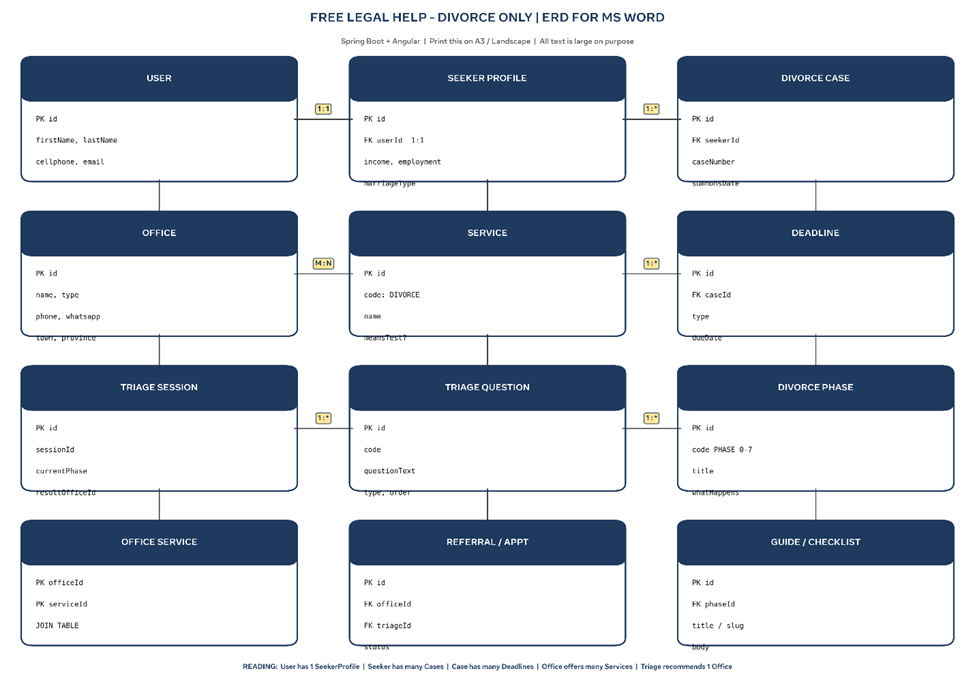

# FREE LEGAL HELP WEBSITE - DIVORCE ONLY
System Design Document
South Africa - Free State Focus

## 1. WEBSITE CONCEPT

Tagline: Divorce in South Africa, explained in plain language. Find free help, know your deadlines, know what happens next.

Goal: A user answers 4 questions and in under 2 minutes gets their exact free legal help option, what to bring, and where to go.

Rules for the website:
- No login required
- Mobile-first, low data, must load in under 3 seconds on 3G
- WhatsApp sharing on every result page
- Languages: Start English, then add Sesotho and Afrikaans for Free State
- Disclaimer: This is free general information, not legal advice. We do not sell your data.

## 2. WEBSITE PAGES

Page 1: Home
Headline: Need a lawyer but cannot afford one? Find free help near you.
Buttons:
- I got a court summons
- I want to start a divorce
- Divorce is final, but I have a problem after
- I have a court date soon

Page 2: Find Help / Triage
This is the heart of the site. 4 steps, 1 question per screen.

Page 3: Divorce Phases
Interactive timeline of 8 phases. User clicks their phase.

## Page 4: Directory
Filter by Province, Town, and Problem. Each office shows what they do, what they do not do, phone, WhatsApp, hours, languages.

Page 5: Guides
One page per problem, plain language, 5 minute read.

Page 6: Deadline Calculator
User enters date summons was served. System calculates last day to file.

Page 7: For NGOs
Form where Legal Aid offices, clinics and advice offices can update their own details.

##  3. DIVORCE TRIAGE - QUESTIONS AND RESULTS

Question 1: Where are you in the process?
- I am thinking about divorce
- I just got a summons / My partner served me
- I want to start a divorce
- I already filed / waiting for court
- Divorce is final, but I have a problem after

Question 2: Are there minor children?
- Yes
- No

Question 3: How did you marry?
- In community of property (no contract)
- Out of community WITH accrual
- Out of community WITHOUT accrual
- Customary marriage / Religious marriage
- Not sure

Question 4: What do you earn per month?
- Under R5,000
- R5,000 to R14,500
- Over R14,500
- No income
- Not sure

Question 5: How urgent is it?
- Court date this week
- This month
- Just need advice

Result Page Shows:
- You likely qualify for: Legal Aid SA - Bloemfontein
- Address
- Phone: 051 407 4300 / 0800 110 110
- Take these 5 things: ID, Summons, 3 months bank statements, Payslip or SASSA card, Proof of address
- Warning: Your 10 days to defend starts from...
- Buttons: Get Checklist as PDF, Send to WhatsApp, Get Directions

If user does not qualify, show next best option: UFS Law Clinic, ProBono.org, Small Claims Court.

## 4. THE 8 PHASES OF DIVORCE IN SOUTH AFRICA

Phase 0: Before You File - Thinking About It
What happens: You are deciding if divorce is the right step.
Grounds: South Africa is no-fault divorce. Only question is: Has the marriage broken down irretrievably?
What to gather first: Marriage certificate, IDs, children's birth certificates, bank statements, proof of assets and debts, pension or RA details.
Warning: Do not leave the house with children or take furniture without advice. It can hurt your case later.
Free help: Family Advocate for parenting plan advice, Legal Aid for advice.

Phase 1: Filing / Summons
What happens: Plaintiff files Summons and Particulars of Claim at High Court if property or pension is involved, or Regional Court.
Sheriff serves it on Defendant.
Cost if private: R15,000 to R40,000 to start. Free if you qualify for Legal Aid.
If you are the Plaintiff: This is where you choose what you ask for - divorce, custody, maintenance, division of property, pension interest.

Phase 2: Notice of Intention to Defend - Critical Deadline
What happens: Defendant must respond.
Deadline: 10 COURT days, not calendar days, excludes weekends and public holidays, from date of service to file J788.
File at court and serve a copy on Plaintiff's attorney.
If you miss this: Plaintiff can get default judgment, divorce granted without you.
Free help: You can file this yourself at court, Legal Aid will help.

Phase 3: Plea and Counterclaim
Deadline: 20 COURT days after Notice to file Plea, your side of the story.
Counterclaim is NOT attacking. It is your list of what you want. Example: Joint estate also includes X, Y, Z, not just my RA.
If you do not file Plea: You get barred, court decides without your defence.
Risk: This is where Legal Aid delays hurt people. You need an extension under Rule 27 if Legal Aid has not assigned an attorney yet.

Phase 4: Discovery and Settlement Talks
What happens: Both sides exchange bank statements, payslips, pension values, bond statements, asset lists.
This is where hidden assets come out.
Most divorces settle HERE. Over 70 percent never go to trial.
Family Advocate investigates if there are children: interviews parents and children, makes recommendation on care and contact.
Mediation: Court can order mediation, especially for children.

Phase 5: Pre-Trial / Trial Date
What happens: If no settlement, pre-trial conference, trial date set.
Trial can be 6 months to 2 years later in Bloemfontein High Court.
Trial is where judge decides: custody, maintenance, property split, pension.
If you settle before trial, you sign a Settlement Agreement. Judge makes it an Order of Court.

Phase 6: Decree of Divorce
What happens: Judge grants Decree of Divorce.
You are NOT divorced until this is signed.
Settlement Agreement becomes binding.
Get a copy of the Divorce Order. You will need it for Home Affairs, pension fund, bank, SASSA.

Phase 7: After Divorce - The Part Everyone Forgets
Pension / RA: Pension fund needs certified copy of Decree plus pension interest order to split it. It does NOT happen automatically.
Maintenance: If not paid, go to Maintenance Court. Do not go back to divorce court.
Other tasks: Changing surname, will, beneficiaries, medical aid.
If ex does not follow order: Contempt / enforcement, Legal Aid can help.

## 5. DIRECTORY - OFFICES TO INCLUDE FIRST

For Free State and Gauteng launch:
- Legal Aid SA - 0800 110 110
- Legal Aid SA Bloemfontein - 53 Charlotte Maxeke Street, 2nd Floor, Colonial Building - 051 407 4300
- University of Free State Law Clinic - 051 401 9973
- Family Advocate - Bloemfontein High Court
- Maintenance Court - Bloemfontein
- CCMA - 0861 16 16 16
- ProBono.org
- Community Advice Offices

For each office list:
- Name
- Type
- What they help with
- What they do NOT help with
- Phone, WhatsApp, Email, Website
- Address, Town, Province
- Operating hours
- Languages spoken
- Waiting time note, for example: Waiting 2 to 4 weeks for attorney assignment

## 6. BACKEND - SPRING BOOT DOMAIN MODEL

Technology: Spring Boot backend, Angular 22 frontend, Nx workspace.

Entity 1: User
Fields: id, firstName, lastName, cellphone, email, idNumber (encrypted), preferredLanguage, role, province, town, createdAt
Roles: SEEKER, OFFICE_ADMIN, SYSTEM_ADMIN, VOLUNTEER
Languages: ENGLISH, SESOTHO, AFRIKAANS, ISIZULU

Entity 2: SeekerProfile
One to one with User. Can exist without login for anonymous triage.
Fields: monthlyIncome, employmentStatus, hasMinorChildren, marriageType, currentPhase, hasCourtDate, courtDate
Income: UNDER_5000, 5000_14500, OVER_14500, NO_INCOME, UNKNOWN
Employment: EMPLOYED, UNEMPLOYED, SASSA, SELF_EMPLOYED
Marriage Type: IN_COMMUNITY, OUT_WITH_ACCRUAL, OUT_WITHOUT_ACCRUAL, CUSTOMARY, RELIGIOUS, UNKNOWN

Entity 3: Office
Fields: id, name, type, description, whatTheyDo, whatTheyDontDo, phone, whatsapp, email, website, addressLine1, town, province, gpsLat, gpsLng, operatingHours, languagesSpoken, isActive, verifiedAt, verifiedBy, capacityNotes
Types: LEGAL_AID, LAW_CLINIC, FAMILY_ADVOCATE, MAINTENANCE_COURT, CCMA, ADVICE_OFFICE, PRO_BONO, PRIVATE_ATTORNEY

Entity 4: Service
Fields: id, code, name, description, requiresMeansTest, urgent
Codes: DIVORCE, MAINTENANCE, PROTECTION_ORDER, CUSTODY, EVICTION, CRIMINAL

Entity 5: OfficeService
Join table for Many to Many between Office and Service.
Fields: officeId, serviceId
Purpose: Not all offices offer all services. Example: Legal Aid Bloemfontein offers DIVORCE_DEFENCE, MAINTENANCE, PROTECTION_ORDER.

Entity 6: TriageSession
Anonymous, no login required.
Fields: id, sessionId, problemType, currentPhase, incomeBracket, marriageType, hasChildren, urgency, resultOfficeId, resultEligibility, createdAt, completedAt
Eligibility: LIKELY_QUALIFIES, MAYBE, DOES_NOT_QUALIFY, REFER_TO_OTHER
Urgency: COURT_THIS_WEEK, THIS_MONTH, ADVICE_ONLY

Entity 7: TriageQuestion
So questions can change without redeploying.
Fields: id, code, questionText English, questionText Sesotho, questionType, order, nextQuestionLogic
Types: SINGLE_CHOICE, YES_NO, DATE

Entity 8: TriageAnswerOption
Fields: id, questionId, label, value, nextQuestionId

Entity 9: TriageRule
Decision engine rules.
Example: If income less than 14500 AND phase equals SUMMONS then recommend LEGAL_AID.
Store rules in database, do not hardcode if-else in Java.

Entity 10: DivorcePhase
Fields: id, code, title, summary, whatHappens, howLong, commonMistakes, order
Codes: PHASE_0_THINKING, PHASE_1_FILING, PHASE_2_SUMMONS, PHASE_3_PLEA, PHASE_4_DISCOVERY, PHASE_5_TRIAL, PHASE_6_DECREE, PHASE_7_AFTER

Entity 11: PhaseChecklistItem
Fields: phaseId, title, description, isRequired
Example Phase 2: Bring ID, Bring Summons, Bring proof of income.

Entity 12: Guide
Fields: id, phaseId, slug, title, body, language, readTimeMinutes
Example slug: what-happens-after-summons

Entity 13: DivorceCase
Only if user creates account or opts in.
Fields: id, seekerId, officeId, caseNumber, courtName, summonsServedDate, status, isPlaintiff
Court: HIGH_COURT_BLOEMFONTEIN, REGIONAL_COURT
Status: ACTIVE, SETTLED, FINALISED, ABANDONED

Entity 14: Deadline
Fields: id, caseId, type, dueDate, isCompleted, completedAt, reminderSent
Types: NOTICE_TO_DEFEND, PLEA, DISCOVERY, TRIAL_DATE, MAINTENANCE_HEARING
Due date calculated: Summons date plus 10 court days, excluding weekends and public holidays.

Entity 15: Referral
Fields: id, triageSessionId, fromOfficeId, toOfficeId, reason, status, referralCode
Status: PENDING, ACCEPTED, REJECTED
Referral code is shown to user to present at office.

Entity 16: Appointment
Fields: id, officeId, seekerId, dateTime, status, notes
Status: REQUESTED, CONFIRMED, COMPLETED, MISSED
Note: Do not build full booking in version 1. Referral code plus Call this office is enough.

Entity 17: PublicHoliday
Fields: date, name
Purpose: Needed for deadline calculator. Example: 16 June Youth Day.

Entity 18: Faq
Fields: question, answer, phaseId, language

Entity 19: Feedback
Fields: triageSessionId, wasHelpful, comment
Purpose: Prove impact to funders.

Relationships Summary
- User 1 to 1 SeekerProfile
- User 1 to many Case
- Case 1 to many Deadline
- Office many to many Service via OfficeService
- Office 1 to many Appointment
- Office 1 to many Referral
- TriageSession many to 1 Office (recommended)
- TriageSession 1 to 1 Referral
- DivorcePhase 1 to many PhaseChecklistItem
- DivorcePhase 1 to many Guide
- DivorcePhase 1 to many Faq

## 7. SPRING BOOT PROJECT STRUCTURE

Package: za.co.divorcehelp

Controllers:
- TriageController
- OfficeController
- PhaseController
- DeadlineController
- GuideController

Services:
- TriageService (rules engine)
- DeadlineCalculatorService (court days)
- OfficeService

Repositories:
- OfficeRepository
- TriageSessionRepository
- DivorcePhaseRepository
- DeadlineRepository

Entities:
- User, Office, TriageSession, DivorcePhase, Deadline, etc.

DTOs:
- TriageRequest, TriageResult, OfficeDto

Config:
- SecurityConfig (public endpoints for triage, auth for admin)

Key Design Decisions
1. Triage endpoints must be PUBLIC. No JWT required. Example: /api/public/triage. Otherwise people will not use it.
2. Encrypt ID numbers. Use JPA AttributeConverter plus AES. Do not store plain.
3. Court days calculator must be a separate service. Inject PublicHolidayRepository. Test it heavily.
4. Office data must be editable by Office Admins, not just you. Add OfficeAdmin role that can only edit their office.

8. BUILD ORDER

Backend order:
1. Office plus Service plus OfficeService CRUD. You need data before frontend works.
2. DivorcePhase plus Guide plus Checklist. Static content API for Angular.
3. TriageSession plus TriageRule. Decision engine.
4. DeadlineCalculator. POST /api/public/deadlines/calculate with summonsDate.
5. Case plus Deadline. Only if you add accounts later.

Frontend order:
1. Phases pages. Static, high SEO value.
2. Triage. Interactive tool.
3. Deadline Calculator. Viral tool.

## 9. LAUNCH PLAN

Week 1: Build Find Help plus 3 guides (Divorce Summons, Maintenance, Protection Order) plus Free State directory only.
Week 2: Test with 5 real people in Bloemfontein. Watch them use it, see where they get stuck.
Week 3: Add Deadline Calculator plus WhatsApp share, launch on Facebook community groups.

## ENTITY RELATIONSHIP DIAGRAM

  

